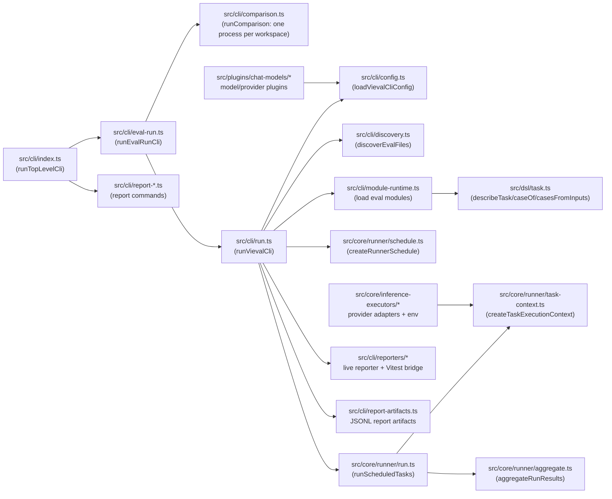
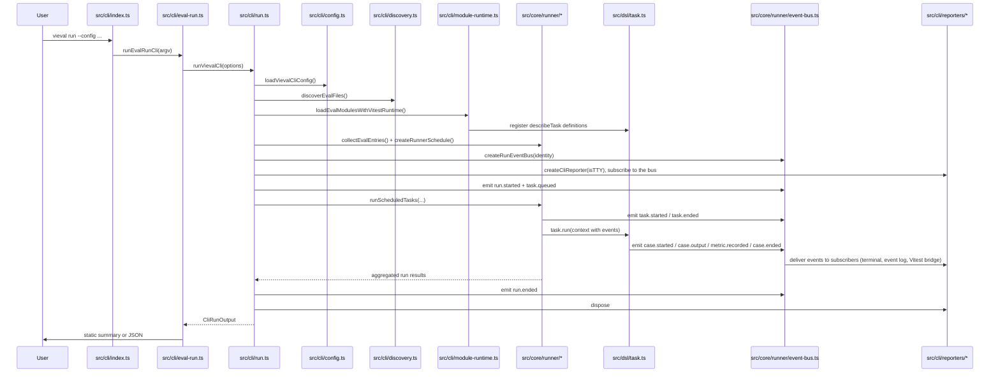

# Vieval

[![npm version][npmx-version-src]][npmx-version-href]
[![npm downloads][npmx-downloads-src]][npmx-downloads-href]
[![bundle][bundle-src]][bundle-href]
[![License][license-src]][license-href]
[![JSDocs][jsdocs-src]][jsdocs-href]

Vitest-style evaluation framework for agents, models, and task pipelines.

`vieval` keeps eval authoring close to product code while giving you repeatable task discovery, matrix scheduling, live CLI output, JSON artifacts, and report commands.

## Why Vieval

- Familiar eval files with `describeTask`, `caseOf`, `casesFromInputs`, and `expect`.
- Project, eval, and task matrix layers for model, scenario, rubric, and dataset variants.
- Built-in chat-model registration through `ChatModels`, plus custom project executors for non-chat workloads.
- Human-readable terminal output and machine-readable JSON/report artifacts from the same CLI.
- Importable runner, scheduler, assertion, config, plugin, and testing entrypoints for advanced integration.

## Quick Start

### Step 1. Create a config

```ts
// vieval.config.ts
import { cwd } from 'node:process'

import { defineConfig, loadEnv, requiredEnvFrom } from 'vieval'
import { chatModelFrom, ChatModels } from 'vieval/plugins/chat-models'

export default defineConfig({
  env: loadEnv('test', cwd(), ''),
  plugins: [
    ChatModels({
      models: [
        chatModelFrom({
          aliases: ['agent-mini', 'judge-mini'],
          apiKey: config => requiredEnvFrom(config.env, {
            name: 'OPENAI_API_KEY',
            type: 'string',
          }),
          inferenceExecutor: 'openai',
          model: 'gpt-4.1-mini',
        }),
      ],
    }),
  ],
  projects: [
    {
      evalMatrix: {
        extend: {
          rubric: ['default'],
        },
      },
      include: ['evals/*.eval.ts'],
      name: 'default',
      root: '.',
      runMatrix: {
        extend: {
          model: ['agent-mini'],
          scenario: ['baseline'],
        },
      },
    },
  ],
})
```

### Step 2. Create an eval task

```ts
// evals/smoke.eval.ts
import { caseOf, describeTask, expect } from 'vieval'

describeTask('smoke', () => {
  caseOf('arithmetic-default', (context) => {
    expect(context.task.matrix.run.scenario).toBe('baseline')
    expect(2 + 2).toBe(4)
  }, {
    input: {
      prompt: 'Check simple arithmetic.',
    },
  })
})
```

### Step 3. Run

```bash
pnpm -F vieval eval:run -- --config ./vieval.config.ts
```

The published binary form is:

```bash
vieval run --config ./vieval.config.ts
```

## Authoring API

Use `describeTask` for the common Vitest-like authoring path:

```ts
import { caseOf, describeTask, expect } from 'vieval'
import { modelFromRun } from 'vieval/plugins/chat-models'

describeTask('prompt-language-ablation', () => {
  caseOf('resolves matrix axes', async (context) => {
    const selectedModel = modelFromRun(context, { axis: 'model' })
    const language = context.task.matrix.run.promptLanguage
    const scenario = context.task.matrix.run.scenario

    expect(selectedModel.id.length).toBeGreaterThan(0)
    expect(language).toBeDefined()
    expect(scenario).toBeDefined()
  }, {
    input: {
      prompt: 'Summarize the position in one sentence.',
    },
  })
})
```

Use builder style when loading a batch of inputs:

```ts
import { describeTask, expect } from 'vieval'

const arithmeticCases = [
  { input: { a: 1, b: 2, expected: 3 }, name: 'addition-small' },
  { input: { a: 20, b: 22, expected: 42 }, name: 'addition-large' },
]

describeTask('arithmetic-quality', ({ casesFromInputs }) => {
  casesFromInputs('arithmetic-case', arithmeticCases, ({ matrix }) => {
    const result = matrix.inputs.input.a + matrix.inputs.input.b
    expect(result).toBe(matrix.inputs.input.expected)
  })
})
```

Declare the scores a task measures with `defineScore`. Each score is a named value in `0..1` where higher is better; one score per task is `primary` and becomes the headline, shown next to the completion rate. A derived score (`combine: { all | mean | weighted }`) is computed by the runtime when the case try settles:

```ts
import { caseOf, defineScore, describeTask } from 'vieval'

const correct = defineScore('formula.correct', { label: { 'en': 'Correct', 'zh-Hans': '正确' } })
const natural = defineScore('formula.natural', { grader: { id: 'judge', kind: 'model' } })
const pass = defineScore('formula.pass', {
  combine: { all: [correct, { atLeast: 0.5, score: natural }] },
  label: 'Pass',
  primary: true,
})

describeTask('read-formula', () => {
  caseOf('fraction', async (context) => {
    const { listenerScore, verdict } = await readAloud('1/2')
    context.recordScore(correct, listenerScore)
    if (verdict == null)
      context.recordUnscored(natural, 'invalid_response')
    else
      context.recordScore(natural, verdict.score, { rationale: verdict.reason })
  })
}, { scores: [correct, natural, pass] })
```

A failed case counts `0` in every score. An errored or timed-out case is left out (`errors: 'exclude'`, the default) or counts `0` (`errors: 'zero'`), and lowers the completion rate either way. An unscored value never counts. Latency and cost are metrics (`defineMetric` with `better: 'lower'`), not scores.

`describeEval` remains exported as an alias of `describeTask`, but new examples should prefer `describeTask` because task/case semantics are the primary runtime model.

Every `describeTask` call in an eval file is its own task:

- The entry name is the `describeTask` name.
- The entry id is the file path relative to the project root, without `.eval.*`, plus `#<name>` when the name differs from the file name. For example, `evals/speech.eval.ts` registering `zh` and `en` gives `evals/speech#zh` and `evals/speech#en`; registering only `speech` gives `evals/speech`.
- Two tasks with the same name in one file are an error.
- Without `include`, a project collects `**/*.eval.{ts,mts,cts,js,mjs,cjs}`.

## Matrix Model

`vieval` expands matrix scopes in this order:

1. Project config from `vieval.config.*`.
2. Eval definition from `defineEval(...)`.
3. Task definition from `defineTask(...)`.

Within each scope, matrix layers resolve in this order:

1. `disable`
2. `extend`
3. `override`

Both `runMatrix` and `evalMatrix` are supported at project, eval, and task scope. A flat object such as `runMatrix: { scenario: ['baseline'] }` is normalized to `runMatrix.extend`; layered form is preferred for new docs and examples.

Each scheduled task receives stable matrix metadata:

- `task.matrix.run`
- `task.matrix.eval`
- `task.matrix.meta.runRowId`
- `task.matrix.meta.evalRowId`
- `task.matrix.inputs` for `caseOf(..., { input })` and `casesFromInputs(...)`

## Orchestration Model

`vieval` separates benchmark management from run reliability. The run hierarchy is `comparison → workspace → project → task → case`:

- `comparison`: the outermost level. It lists `workspaces` and runs each one in its own process, side by side, for horizontal evaluation across multiple agent, memory, model, paper, or backend implementations. Workspaces do not need perfect project/case alignment. See [Workspaces and Comparisons](#workspaces-and-comparisons).
- `workspace`: a config that lists `projects`, inline or collected from other configs. It selects and schedules projects and provides their env. A config without `workspaces` is a workspace.
- `project`: the complete unit of work: discovery rules (`include`, `exclude`, `root`), `runMatrix` / `evalMatrix`, `models`, `inferenceExecutors`, optional `executor`, `plugins`, `reporters`, and `scheduler`.
- `experiment`: run metadata derived from explicit `--experiment` or, when omitted, stable matrix row metadata. It does not create an extra scheduler layer.
- `task`: one eval definition discovered from files and expanded across inference executors plus run/eval matrix rows.
- `case`: the scoring and evidence source inside a task. `context.recordScore(score, value)` records a named score declared with `defineScore` (a value in `0..1`, higher is better; one score per task is the primary score); `context.recordUnscored(score, reason)` records that the grader could not produce one; `context.recordMetric(...)` emits benchmark data such as latency or cost for reports.
- `completion rate`: the share of cases that produced a result (`passed` or `failed`, not `errored` or `timeout`). It is shown next to the primary score everywhere.
- `attempt`: a full task rerun used to estimate reliability. With `autoAttempt`, each full attempt contributes evidence, so a fail-then-pass pair scores as a success rate rather than replacing the earlier failure.
- `retry`: an in-case retry. With `autoRetry`, a case can recover inside one attempt; a retry pass still counts as that attempt passing.

Config inheritance follows the same outside-in model: top-level `models` and `reporters` of a workspace are defaults for projects that set none, top-level `plugins` transform the config when it loads, and project-local plugins can append or override project-local models/reporters/concurrency without leaking to sibling projects. `env`, `scheduler`, and `reporting` apply to the whole workspace. The scheduler is the exception to inheritance: top-level `scheduler` (concurrency pools and middleware) is not copied into projects; it configures the run, and each project's `scheduler` configures that project below it.

## Config Example

```ts
import { cwd } from 'node:process'

import { defineConfig, loadEnv, requiredEnvFrom } from 'vieval'
import { chatModelFrom, ChatModels } from 'vieval/plugins/chat-models'

export default defineConfig({
  env: loadEnv('test', cwd(), ''),
  plugins: [
    ChatModels({
      models: [
        chatModelFrom({
          aliases: ['agent-mini', 'judge-mini'],
          apiKey: config => requiredEnvFrom(config.env, {
            name: 'OPENAI_API_KEY',
            type: 'string',
          }),
          inferenceExecutor: 'openai',
          model: 'gpt-4.1-mini',
        }),
        chatModelFrom({
          aliases: ['agent-large', 'judge-large'],
          apiKey: config => requiredEnvFrom(config.env, {
            name: 'OPENAI_API_KEY',
            type: 'string',
          }),
          inferenceExecutor: 'openai',
          model: 'gpt-4.1',
        }),
        chatModelFrom({
          aliases: ['agent-openrouter-mini'],
          apiKey: config => requiredEnvFrom(config.env, {
            name: 'OPENROUTER_API_KEY',
            type: 'string',
          }),
          inferenceExecutor: 'openrouter',
          model: 'openai/gpt-4.1-mini',
        }),
      ],
    }),
  ],
  projects: [
    {
      evalMatrix: {
        extend: {
          rubric: ['strict', 'lenient'],
          rubricModel: ['judge-mini', 'judge-large'],
        },
      },
      include: ['evals/*.eval.ts'],
      name: 'chat-evals',
      root: '.',
      runMatrix: {
        extend: {
          model: ['agent-mini', 'agent-large'],
          promptLanguage: ['en', 'zh'],
          scenario: ['baseline', 'stress'],
        },
      },
    },
  ],
})
```

## Custom Executor

If a project provides no `executor`, `vieval run` still discovers eval files, schedules tasks, and executes module-defined task callbacks. Provide `projects[].executor` when a project needs custom execution for ASR, TTS, image, motion, hosted agents, or another domain runtime.

```ts
import { defineConfig } from 'vieval'
import { scoreCases } from 'vieval/core/scoring'

export default defineConfig({
  projects: [
    {
      async executor(task, context) {
        const model = context.models.find(model =>
          model.id === 'motion-default'
          || model.model === 'motion-default'
          || model.aliases.includes('motion-default'),
        )

        if (model == null) {
          throw new Error('Missing configured model "motion-default".')
        }

        const success = model.model === 'v2' && task.matrix.run.scenario === 'baseline'

        return {
          entryId: task.entry.id,
          id: task.id,
          inferenceExecutorId: task.inferenceExecutor.id,
          matrix: task.matrix,
          // One measurement as one passed outcome; `scoreCases` builds `scores`, `primary`, `completion`, and `passed`.
          ...scoreCases([{ scores: { 'motion.success': success ? 1 : 0 }, state: 'passed', unscored: {} }]),
        }
      },
      include: ['evals/*.eval.ts'],
      inferenceExecutors: [{ id: 'motion-engine' }],
      models: [
        {
          aliases: ['motion-default'],
          id: 'motion-engine:v2',
          inferenceExecutor: 'motion-engine',
          inferenceExecutorId: 'motion-engine',
          model: 'v2',
        },
      ],
      name: 'motion-evals',
      root: '.',
    },
  ],
})
```

## Workspaces and Comparisons

`vieval run` reads one config and runs the level it describes. A config that lists `workspaces` is a comparison; any other config is a workspace that lists `projects`.

```text
comparison     lists workspaces, runs each one in its own process
 └─ workspace  lists projects, runs them in one process
     └─ project  eval files, matrices, models, executors, plugins, reporters, scheduler
         └─ task → case
```

### Workspace: collect projects from other configs

`projects` entries are inline project objects or references to other configs: a path or glob string, or `{ from, env?, scheduler? }`.

```ts
// vieval.config.ts
import { defineConfig } from 'vieval'

export default defineConfig({
  projects: [
    // Every packages/*/vieval.config.*; directories without a config are skipped.
    'packages/*',
    { env: { LEGACY_MODE: '1' }, from: 'agents/legacy' },
    { include: ['smoke/**/*.eval.ts'], name: 'smoke' },
  ],
})
```

- `from` is a config file, a directory that holds a `vieval.config.*`, or a glob of such directories, relative to the workspace config.
- A collected project loads with its own config: its plugins, models, reporters, and root. It runs as it does from its own config.
- Projects of one workspace share one process, so env is process-wide: the workspace's `env`, the `env` of each referenced config, and the reference's `env` are merged. A key with two different values is an error; run such projects as workspaces of a comparison instead.
- `scheduler` on a reference replaces the scheduler of the collected projects.
- Project names must be unique in a workspace. A reference cycle is an error.

### Comparison: run workspaces side by side

```ts
// evals/agent-memory/vieval.config.ts
import { defineConfig, loadEnv } from 'vieval'

export default defineConfig({
  cache: { namespace: 'locomo-cases-v1' },
  env: loadEnv('test', import.meta.dirname, ''),
  id: 'agent-memory-semantic-approaches',
  workspaces: ['eval/test-objects/*'],
})
```

- `workspaces` entries are paths or globs of directories that hold a `vieval.config.*` (relative to the comparison config), `'!<glob>'` to exclude directories, or `{ root, id?, env? }`. A workspace id defaults to its directory name. Duplicate ids are an error.
- `id` defaults to the name of the comparison config's directory.
- A comparison has no `models`, `plugins`, or `reporters`: each workspace runs with its own config.
- `env` (and the `env` of an entry) wins over the `env` of each workspace config. It is applied before the workspace's plugins run, so plugins that read `config.env` (for example model API keys) see it.
- `cache: { namespace }` makes all workspaces share `.vieval/cache/<comparison id>/<namespace>/` next to the comparison config. Without it, each project caches under its own root.
- `concurrency: { workspace }` (or `--workspace-concurrency`) limits how many workspaces run at once. The default is all at once.

`vieval run --config evals/agent-memory/vieval.config.ts` runs every workspace in its own process, with the `vieval` that the workspace resolves. That `vieval` must be the same version, so the workspace's dependencies must be installed.

- One live terminal window shows `Workspaces`, `Projects`, `Tasks`, `Cases`, `Concurrency`, and `Time` rows for all workspaces.
- A failing workspace does not stop the others.
- At the end, a leaderboard prints one row per workspace and project, ranked by the primary score with the completion rate in its own column, then the failed workspaces with the last lines of their stderr. If the workspaces have different primary scores, the leaderboard says so and ranks by passed cases.
- The exit code is `1` when any workspace failed or had failing cases.
- `--json` prints the comparison output.
- Reports go to `.vieval/reports` next to the comparison config. The experiment defaults to the comparison id, and all workspaces share one attempt.

### Select what runs

Selectors on `vieval run` are repeatable. A value that contains `*` is a glob.

- `--workspace <id>`: workspaces of a comparison. It is an error on a workspace config.
- `--project <name>`: projects.
- `--task <name>`: tasks, by `describeTask` name or entry id.
- `--case <name>`: cases, by case name.

A selector that matches nothing is an error that lists what exists. In a comparison, `--project`, `--task`, and `--case` must match in at least one workspace.

```bash
vieval run --config evals/agent-memory/vieval.config.ts --workspace mem9 --with-viewer --open
vieval run --task zh --case 'case #1*'
```

## CLI

```bash
vieval run [--config <path>] [--workspace <id>] [--project <name>] [--task <name>] [--case <name>] [--json] [--report-out <path> | --no-report]
vieval run --with-viewer [--port <port>] [--host <host>] [--open]
vieval viewer [reportRoot...] [--port <port>] [--host <host>] [--open]
vieval report analyze <report-directory>
vieval report index <report-directory> [--output <path>] [--format table|json|jsonl]
vieval report cases <report-directory> [--where <key=value>] [--group-by <key>] [--format table|json|jsonl]
vieval report compare <left-report-directory> <right-report-directory> [--case-key <key>] [--score <name>] [--format table|json]
```

`vieval run --config <comparison config>` runs a comparison; there is no separate `vieval compare` command. `vieval report compare` diffs two existing reports.

`vieval run` writes reports by default under `.vieval/reports` next to the config file. `--report-out <path>` changes the root, and `--no-report` writes nothing. Every project is its own run, under `<root>/<workspace>/<project>/<experiment>/<attempt>/<run>/`.

Common workspace commands:

```bash
pnpm install
pnpm -F vieval eval:run
pnpm -F vieval eval:run -- --config ./vieval.config.ts
pnpm -F vieval eval:run -- --config ./vieval.config.ts --project chess --project moderation
pnpm -F vieval eval:run -- --json
pnpm -F vieval eval:run -- --report-out .vieval/reports --experiment prompt-v2 --attempt attempt-a
pnpm -F vieval eval:run -- --task zh --case 'case #1*'
pnpm -F vieval exec tsx src/bin/vieval.ts run --config evals/agent-memory/vieval.config.ts
pnpm -F vieval exec tsx src/bin/vieval.ts run --config evals/agent-memory/vieval.config.ts --workspace mem9 --with-viewer --open
pnpm -F vieval exec tsx src/bin/vieval.ts report analyze .vieval/reports/my-run
pnpm -F vieval eval:run -- --help
```

Concurrency flags are available on `vieval run`. Each one bounds the whole run, and it is combined with the same key of the top-level `scheduler.concurrency` config by taking the smaller value, so a flag never raises a configured value:

- `--workspace-concurrency`: the most workspaces of a comparison running at once (default: all at once). The same as `concurrency.workspace` in a comparison config.
- `--project-concurrency`: the most projects running at once. Without a run-wide `task` or `case` pool (in config or on the CLI), projects run one at a time. With one, projects are bounded only by those pools, so the next project starts while a slow case of another project still runs.
- `--task-concurrency`: the most scheduled tasks running at once in the whole run. Without a run-wide `task` or `case` value and without a project `task` value, each project runs one task at a time.
- `--case-concurrency`: the most cases running at once in the whole run.

A concurrency value is shared by the work where it is declared: top-level `scheduler.concurrency` and CLI values bound the whole run, a project's `scheduler.concurrency` bounds that project, `describeTask(..., { concurrency: { case } })` bounds that task, and `casesFromInputs(..., { concurrency })` bounds that group. A case runs only after it holds a slot at every level, so `scheduler: { concurrency: { case: 7 } }` at the top level keeps the whole run at seven cases however many tasks run at once.

## Public Entrypoints

- `vieval`: `defineConfig`, `loadEnv`, `requiredEnvFrom`, `describeTask`, `describeEval`, `caseOf`, `casesFromInputs`, `defineScore`, `defineMetric`, and `expect`.
- `vieval/config`: lower-level `defineEval`, `defineTask`, matrix types, task context types, model definitions, and plugin contracts.
- `vieval/plugins/chat-models`: `ChatModels`, `ChatProviders`, `chatModelFrom`, `chatProviderFrom`, `chatModelMatrix`, runtime config helpers, and chat telemetry helpers.
- `vieval/core/runner`: collection, scheduling, task context, cache runtime, scheduler, execution, and aggregation utilities.
- `vieval/core/assertions`: assertion primitives and pipeline helpers. Outcomes carry a `score`; record it with `context.recordScore(definition, outcome.score)`.
- `vieval/core/scoring`: the one scoring rule (`scoreCases`), derived scores (`deriveScores`), pooling (`poolScoreSummaries`), and headline resolution (`resolveHeadline`). Side-effect free.
- `vieval/core/inference-executors`: env helpers and remote provider executors.
- `vieval/testing/expect-extensions`: Vitest expect extensions for testing eval behavior.

## Architecture



### Runtime Sequence



## Examples In This Repository

- [Define a custom eval task API](packages/vieval/tests/projects/example-api-defining-new-task)
- [Configure run/eval matrix combinations](packages/vieval/tests/projects/example-api-config-matrix)
- [Load datasource records as task cases](packages/vieval/tests/projects/example-api-load-datasource-as-cases)
- [Use assertion helpers and Vitest expect extensions](packages/vieval/tests/projects/example-api-expect)
- [Compare reporters and experiment/attempt layering](packages/vieval/tests/projects/example-api-reporters-and-experiments)
- [Bring your own agent execution pattern](packages/vieval/tests/projects/example-pattern-byoa-bring-your-own-agent)

## Development

```bash
pnpm install
pnpm -F vieval test:run
pnpm -F vieval typecheck
pnpm lint
```

## When To Use / Not Use

Use `vieval` when:

- you want evals close to app code with Vitest-like ergonomics;
- you need repeatable matrix experiments and stable run metadata;
- you want local diagnostics, CI JSON, and report artifacts from one runner;
- you need to evaluate product code or custom agent flows without moving them into a hosted eval system.

Do not use `vieval` when:

- you need hosted dataset management, annotation UI, or SaaS observability out of the box;
- you only need a one-off script without reusable eval definitions or matrix scheduling.

## Acknowledgements

- [Vitest](https://github.com/vitest-dev/vitest)
- [LobeHub](https://github.com/lobehub/lobehub)
- [EvalSys](https://github.com/evalsys)

## License

MIT

[npmx-version-src]: https://npmx.dev/api/registry/badge/version/vieval
[npmx-version-href]: https://npmx.dev/vieval
[npmx-downloads-src]: https://npmx.dev/api/registry/badge/downloads-month/vieval
[npmx-downloads-href]: https://npmx.dev/vieval
[bundle-src]: https://npmx.dev/api/registry/badge/size/vieval
[bundle-href]: https://bundlephobia.com/result?p=vieval
[license-src]: https://npmx.dev/api/registry/badge/license/vieval
[license-href]: https://github.com/vieval-dev/vieval/blob/main/LICENSE
[jsdocs-src]: https://img.shields.io/badge/jsdocs-reference-080f12?style=flat&colorA=080f12&colorB=1fa669
[jsdocs-href]: https://www.jsdocs.io/package/vieval
