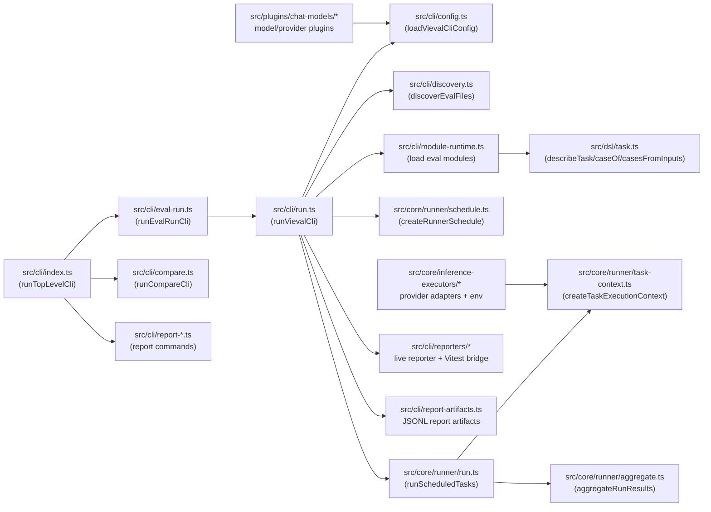
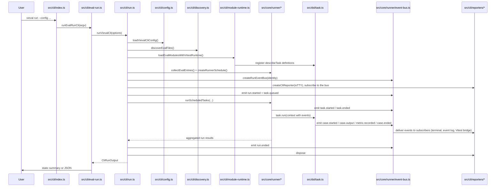

# Vieval

[![npm version][npm-version-src]][npm-version-href]
[![npm downloads][npm-downloads-src]][npm-downloads-href]
[![bundle][bundle-src]][bundle-href]
[![JSDocs][jsdocs-src]][jsdocs-href]
[![License][license-src]][license-href]
[![Ask DeepWiki][deepwiki-src]][deepwiki-href]

Vitest-style evaluation framework for agents, models, and task pipelines.

`vieval` keeps eval authoring close to product code while giving you repeatable task discovery, matrix scheduling, live CLI output, JSON artifacts, and report commands.

## Why Vieval

- Familiar eval files with `describeTask`, `caseOf`, `casesFromInputs`, and `expect`.
- Project, eval, and task matrix layers for model, scenario, rubric, and dataset variants.
- Built-in chat-model registration through `ChatModels`, plus custom project executors for non-chat workloads.
- Human-readable terminal output and machine-readable JSON/report artifacts from the same CLI.
- Importable runner, scheduler, assertion, config, plugin, and testing entrypoints for advanced integration.

## Quick Start

### Step 1. Create a config

```ts
// vieval.config.ts
import { cwd } from 'node:process'

import { defineConfig, loadEnv, requiredEnvFrom } from 'vieval'
import { chatModelFrom, ChatModels } from 'vieval/plugins/chat-models'

export default defineConfig({
  env: loadEnv('test', cwd(), ''),
  plugins: [
    ChatModels({
      models: [
        chatModelFrom({
          aliases: ['agent-mini', 'judge-mini'],
          apiKey: config => requiredEnvFrom(config.env, {
            name: 'OPENAI_API_KEY',
            type: 'string',
          }),
          inferenceExecutor: 'openai',
          model: 'gpt-4.1-mini',
        }),
      ],
    }),
  ],
  projects: [
    {
      evalMatrix: {
        extend: {
          rubric: ['default'],
        },
      },
      include: ['evals/*.eval.ts'],
      name: 'default',
      root: '.',
      runMatrix: {
        extend: {
          model: ['agent-mini'],
          scenario: ['baseline'],
        },
      },
    },
  ],
})
```

### Step 2. Create an eval task

```ts
// evals/smoke.eval.ts
import { caseOf, describeTask, expect } from 'vieval'

describeTask('smoke', () => {
  caseOf('arithmetic-default', (context) => {
    expect(context.task.matrix.run.scenario).toBe('baseline')
    expect(2 + 2).toBe(4)
  }, {
    input: {
      prompt: 'Check simple arithmetic.',
    },
  })
})
```

### Step 3. Run

```bash
pnpm -F vieval eval:run -- --config ./vieval.config.ts
```

The published binary form is:

```bash
vieval run --config ./vieval.config.ts
```

## Authoring API

Use `describeTask` for the common Vitest-like authoring path:

```ts
import { caseOf, describeTask, expect } from 'vieval'
import { modelFromRun } from 'vieval/plugins/chat-models'

describeTask('prompt-language-ablation', () => {
  caseOf('resolves matrix axes', async (context) => {
    const selectedModel = modelFromRun(context, { axis: 'model' })
    const language = context.task.matrix.run.promptLanguage
    const scenario = context.task.matrix.run.scenario

    expect(selectedModel.id.length).toBeGreaterThan(0)
    expect(language).toBeDefined()
    expect(scenario).toBeDefined()
  }, {
    input: {
      prompt: 'Summarize the position in one sentence.',
    },
  })
})
```

Use builder style when loading a batch of inputs:

```ts
import { describeTask, expect } from 'vieval'

const arithmeticCases = [
  { input: { a: 1, b: 2, expected: 3 }, name: 'addition-small' },
  { input: { a: 20, b: 22, expected: 42 }, name: 'addition-large' },
]

describeTask('arithmetic-quality', ({ casesFromInputs }) => {
  casesFromInputs('arithmetic-case', arithmeticCases, ({ matrix }) => {
    const result = matrix.inputs.input.a + matrix.inputs.input.b
    expect(result).toBe(matrix.inputs.input.expected)
  })
})
```

`describeEval` remains exported as an alias of `describeTask`, but new examples should prefer `describeTask` because task/case semantics are the primary runtime model.

### Case ids and artifacts

Every case context carries the ids of the current execution and a directory for its files:

```ts
import { writeFile } from 'node:fs/promises'
import { join } from 'node:path'

import { caseOf, describeTask } from 'vieval'

describeTask('desktop-agent', () => {
  caseOf('opens settings', async (context) => {
    // { runId, attemptId, taskId, caseId }
    console.info(context.ids)

    // Write anything into the case directory; it lives in the run report.
    const screenshotPath = join(context.artifactsDirectory, 'step-1.webp')
    await writeFile(screenshotPath, await captureScreen())

    // Announce the files worth showing. Exactly one of `path` or `body`.
    await context.recordArtifact('step-1.webp', { contentType: 'image/webp', path: screenshotPath, purpose: 'display_capture' })
    await context.recordArtifact('result.json', { body: JSON.stringify({ ok: true }), contentType: 'application/json' })
  })
})
```

- `artifactsDirectory` is `<report directory>/artifacts/<task>/<case>/`, created when read.
- `recordArtifact` records a `path` inside that directory by reference, copies a `path` outside it in as `<name>`, and writes a `body` as `<name>`. It emits an `artifact.recorded` event whose `path` is relative to `<report directory>/artifacts`.
- With `--no-report`, `artifactsDirectory` is a temporary directory removed when the run ends, so eval code does not need to check whether reports are on.
- Outside `vieval run` (for example a test that calls `task.run` directly), `runId` and `attemptId` are `local` and artifacts go to a temporary directory.

## Matrix Model

`vieval` expands matrix scopes in this order:

1. Project config from `vieval.config.*`.
2. Eval definition from `defineEval(...)`.
3. Task definition from `defineTask(...)`.

Within each scope, matrix layers resolve in this order:

1. `disable`
2. `extend`
3. `override`

Both `runMatrix` and `evalMatrix` are supported at project, eval, and task scope. A flat object such as `runMatrix: { scenario: ['baseline'] }` is normalized to `runMatrix.extend`; layered form is preferred for new docs and examples.

Each scheduled task receives stable matrix metadata:

- `task.matrix.run`
- `task.matrix.eval`
- `task.matrix.meta.runRowId`
- `task.matrix.meta.evalRowId`
- `task.matrix.inputs` for `caseOf(..., { input })` and `casesFromInputs(...)`

## Orchestration Model

`vieval` separates benchmark management from run reliability:

- `comparison`: cross-project or cross-workspace benchmark. Use it for horizontal evaluation across multiple agent, memory, model, paper, or backend implementations. Methods do not need perfect project/case alignment; compare artifacts report project and case coverage.
- `workspace`: a batch-management boundary for related eval projects. Use it when one benchmark family spans multiple task projects, roots, env settings, or model registrations.
- `project`: one eval task project with discovery rules, model registrations, optional executor, matrix layers, and scoring/reporting behavior.
- `experiment`: run metadata derived from explicit `--experiment` or, when omitted, stable matrix row metadata. It does not create an extra scheduler layer.
- `task`: one eval definition discovered from files and expanded across inference executors plus run/eval matrix rows.
- `case`: the scoring and evidence source inside a task. `context.recordScore(...)` contributes normalized score evidence; `context.recordMetric(...)` emits benchmark metadata for reports.
- `attempt`: a full task rerun used to estimate reliability. With `autoAttempt`, each full attempt contributes evidence, so a fail-then-pass pair scores as a success rate rather than replacing the earlier failure.
- `retry`: an in-case retry. With `autoRetry`, a case can recover inside one attempt; a retry pass still counts as that attempt passing.

Config inheritance follows the same outside-in model: top-level defaults apply first, workspace/project entries refine them, and project-local plugins can append or override project-local models/reporters/concurrency without leaking to sibling projects. The scheduler is the exception to inheritance: top-level `scheduler` (concurrency pools and middleware) is not copied into projects; it configures the run, and each project's `scheduler` configures that project below it.

## Config Example

```ts
import { cwd } from 'node:process'

import { defineConfig, loadEnv, requiredEnvFrom } from 'vieval'
import { chatModelFrom, ChatModels } from 'vieval/plugins/chat-models'

export default defineConfig({
  env: loadEnv('test', cwd(), ''),
  plugins: [
    ChatModels({
      models: [
        chatModelFrom({
          aliases: ['agent-mini', 'judge-mini'],
          apiKey: config => requiredEnvFrom(config.env, {
            name: 'OPENAI_API_KEY',
            type: 'string',
          }),
          inferenceExecutor: 'openai',
          model: 'gpt-4.1-mini',
        }),
        chatModelFrom({
          aliases: ['agent-large', 'judge-large'],
          apiKey: config => requiredEnvFrom(config.env, {
            name: 'OPENAI_API_KEY',
            type: 'string',
          }),
          inferenceExecutor: 'openai',
          model: 'gpt-4.1',
        }),
        chatModelFrom({
          aliases: ['agent-openrouter-mini'],
          apiKey: config => requiredEnvFrom(config.env, {
            name: 'OPENROUTER_API_KEY',
            type: 'string',
          }),
          inferenceExecutor: 'openrouter',
          model: 'openai/gpt-4.1-mini',
        }),
      ],
    }),
  ],
  projects: [
    {
      evalMatrix: {
        extend: {
          rubric: ['strict', 'lenient'],
          rubricModel: ['judge-mini', 'judge-large'],
        },
      },
      include: ['evals/*.eval.ts'],
      name: 'chat-evals',
      root: '.',
      runMatrix: {
        extend: {
          model: ['agent-mini', 'agent-large'],
          promptLanguage: ['en', 'zh'],
          scenario: ['baseline', 'stress'],
        },
      },
    },
  ],
})
```

## Custom Executor

If a project provides no `executor`, `vieval run` still discovers eval files, schedules tasks, and executes module-defined task callbacks. Provide `projects[].executor` when a project needs custom execution for ASR, TTS, image, motion, hosted agents, or another domain runtime.

```ts
import { defineConfig } from 'vieval'

export default defineConfig({
  projects: [
    {
      async executor(task, context) {
        const model = context.models.find(model =>
          model.id === 'motion-default'
          || model.model === 'motion-default'
          || model.aliases.includes('motion-default'),
        )

        if (model == null) {
          throw new Error('Missing configured model "motion-default".')
        }

        const success = model.model === 'v2' && task.matrix.run.scenario === 'baseline'

        return {
          entryId: task.entry.id,
          id: task.id,
          inferenceExecutorId: task.inferenceExecutor.id,
          matrix: task.matrix,
          scores: [{ kind: 'exact', score: success ? 1 : 0 }],
        }
      },
      include: ['evals/*.eval.ts'],
      inferenceExecutors: [{ id: 'motion-engine' }],
      models: [
        {
          aliases: ['motion-default'],
          id: 'motion-engine:v2',
          inferenceExecutor: 'motion-engine',
          inferenceExecutorId: 'motion-engine',
          model: 'v2',
        },
      ],
      name: 'motion-evals',
      root: '.',
    },
  ],
})
```

## CLI

```bash
vieval run [--config <path>] [--project <name>] [--json] [--report-out <path> | --no-report]
vieval run --with-viewer [--viewer-port <port>] [--viewer-host <host>] [--viewer-open]
vieval viewer [reportRoot...] [--port <port>] [--host <host>] [--open] [--evidence-root <dir>] [--stale-after <min>]
vieval compare [--config <path>] [--comparison <id>] [--output <path>] [--format table|json]
vieval report analyze <report-directory>
vieval report index <report-directory> [--output <path>] [--format table|json|jsonl]
vieval report cases <report-directory> [--where <key=value>] [--group-by <key>] [--format table|json|jsonl]
vieval report compare <left-report-directory> <right-report-directory> [--case-key <key>] [--score-kind <kind>] [--format table|json]
```

`vieval run` writes a report for every run, by default under `.vieval/reports` next to the config file (add `.vieval/` to `.gitignore`). `--report-out <path>` changes the root, and `--no-report` writes nothing. The report directory is `<root>/<workspace>/<project>/<experiment>/<attempt>/<run>/`:

- `events.jsonl` is appended while the run is in progress, so a crashed run keeps the events already flushed to disk. Each line has a `seq` that orders it within the run.
- `run-summary.json`, `cases.jsonl`, `metrics-summary.json`, and `otlp/*.json` are derived from `events.jsonl` when the run ends.
- The same `workspaceId`, `experimentId`, `attemptId`, and `runId` identify the run in every file: the top-level fields of `run-summary.json`, every event envelope, every `cases.jsonl` record, and the `vieval.workspace.id` / `vieval.experiment.id` / `vieval.attempt.id` / `vieval.run.id` attributes of the OTLP resources and the `vieval.run` span.
- For a task with auto attempts, a `cases.jsonl` record describes the last attempt and adds `attemptIndex`, `autoAttempt`, and `attempts` (state, scores, retries, and timing of each attempt). `retryCount` counts only the retries within the last attempt. `CaseRecord.schemaVersion` stays `1`, because the new fields are optional.
- `artifacts/<task>/<case>/` holds case files (see [Case ids and artifacts](#case-ids-and-artifacts)).

Interrupting a run (Ctrl+C, `SIGTERM`, or closing the terminal):

- The first signal stops starting new tasks and cases, and aborts `context.signal` of every running case. vieval then waits for those cases to settle, so their `finally` blocks and abort listeners can release external resources (cloud machines, Pods, browsers). The report is written as usual, the summary ends with `Interrupted by SIGINT`, interrupted cases fail with `Run interrupted by <signal>.`, and the process exits with `128 + signal number` (130 for `SIGINT`).
- A second signal exits immediately, without waiting for cleanup.
- Cases must pass `context.signal` to their long-running work (`fetch`, child processes, timers). A case that ignores it keeps the run waiting until it finishes on its own or the second signal arrives.
- Cleanup code should not use `context.signal` itself; it is already aborted when the cleanup runs.

Common workspace commands:

```bash
pnpm install
pnpm -F vieval eval:run
pnpm -F vieval eval:run -- --config ./vieval.config.ts
pnpm -F vieval eval:run -- --config ./vieval.config.ts --project chess --project moderation
pnpm -F vieval eval:run -- --json
pnpm -F vieval eval:run -- --report-out .vieval/reports --workspace local --experiment prompt-v2 --attempt attempt-a
pnpm -F vieval exec tsx src/bin/vieval.ts compare --config ./vieval.config.ts --comparison agent-memory
pnpm -F vieval exec tsx src/bin/vieval.ts report analyze .vieval/reports/my-run
pnpm -F vieval eval:run -- --help
```

Concurrency flags are available on `vieval run`. Each one bounds the whole run, and it is combined with the same key of the top-level `scheduler.concurrency` config by taking the smaller value, so a flag never raises a configured value:

- `--project-concurrency`: the most projects running at once (default `1`).
- `--task-concurrency`: the most scheduled tasks running at once in the whole run. Without a run-wide `task` or `case` value and without a project `task` value, each project runs one task at a time.
- `--case-concurrency`: the most cases running at once in the whole run.

A concurrency value is shared by the work where it is declared: top-level `scheduler.concurrency` and CLI values bound the whole run, a project's `scheduler.concurrency` bounds that project, `describeTask(..., { concurrency: { case } })` bounds that task, and `casesFromInputs(..., { concurrency })` bounds that group. A case runs only after it holds a slot at every level, so `scheduler: { concurrency: { case: 7 } }` at the top level keeps the whole run at seven cases however many tasks run at once.

### Web viewer

`vieval run --with-viewer` serves the web viewer for the run. The viewer is the optional package `@vieval/ui`; install it next to your config (`pnpm add -D @vieval/ui`).

- `--viewer-port <port>`: port to listen on (default `51204`, the same as `vitest --ui`).
- `--viewer-host <host>`: interface to listen on (default `127.0.0.1`).
- `--viewer-open`: open the viewer in a browser.

vieval loads the package with a dynamic `import()` only when `--with-viewer` is set. If the package is missing, the command fails before the run starts, with exit code 1. The viewer starts when the run is ready and prints `Viewer: <url>` on stderr. After the run, the viewer keeps serving until Ctrl+C. The process then exits with the exit code of the run.

Without `--with-viewer`, vieval does not load any viewer code, and the run output does not change.

With `--no-report`, case artifacts are in a temporary directory that is removed when the run ends, so the viewer cannot show them after the run.

`vieval viewer [reportRoot...]` serves the same viewer for report directories, without running evals (like `vitest --ui` for results). The default report root is `.vieval/reports` in the current directory, or next to `--config`. A run that another process is still writing (only `events.jsonl` exists) is tailed and updated live. Options: `--port` (default `51204`), `--host` (default `127.0.0.1`), `--open`, `--evidence-root <dir>` (repeatable: extra directories that `*.evidence` metric paths may point into), `--stale-after <min>` (default `60`). See `packages/ui/README.md` and `packages/ui/API.md`.

### Attach a host to a run (`onRunReady`)

Other hosts (the viewer, a dashboard, a custom CLI) attach to a run with the `onRunReady` option of `runVievalCli` from `vieval/cli`:

```ts
import { runVievalCli } from 'vieval/cli'

await runVievalCli({
  configFilePath: './vieval.config.ts',
  onRunReady({ bus, identity, reportDirectory }) {
    // identity: { workspaceId, experimentId, attemptId, runId }
    const unsubscribe = bus.onAny(envelope => console.error(envelope.seq, envelope.event))
    return () => unsubscribe() // called after the run settled and its reports are written
  },
})
```

- vieval calls the hook once, after the terminal reporter subscribed and before `run.started`. The host therefore receives every event from `seq` 1, the same events that go to `events.jsonl`.
- The context also has `artifactsRoot`, `configFilePath`, `projectNames`, `reportDirectory`, and `reportRoot` (the last two are `null` with `--no-report`).
- If the hook or its cleanup throws, vieval writes the error to stderr. The run continues, and its result does not change.
- `vieval/cli` also exports the viewer contract types (`ViewerModule`, `ViewerHost`, `StartViewerOptions`) for packages that implement a viewer.

## Public Entrypoints

- `vieval`: `defineConfig`, `loadEnv`, `requiredEnvFrom`, `describeTask`, `describeEval`, `caseOf`, `casesFromInputs`, and `expect`.
- `vieval/config`: lower-level `defineEval`, `defineTask`, matrix types, task context types, model definitions, and plugin contracts.
- `vieval/plugins/chat-models`: `ChatModels`, `ChatProviders`, `chatModelFrom`, `chatProviderFrom`, `chatModelMatrix`, runtime config helpers, and chat telemetry helpers.
- `vieval/core/runner`: collection, scheduling, task context, cache runtime, scheduler, execution, and aggregation utilities.
- `vieval/core/assertions`: assertion primitives and pipeline helpers.
- `vieval/events`: run event definitions, payload types, and `events.jsonl` schemas.
- `vieval/core/inference-executors`: env helpers and remote provider executors.
- `vieval/testing/expect-extensions`: Vitest expect extensions for testing eval behavior.

## Architecture



### Runtime Sequence



### Case Output

`vieval run` executes cases concurrently in one process. While a run is active, the CLI intercepts `process.stdout` / `process.stderr` (and so `console.*`) and folds the output of each case, like `pnpm -r run` folds the output of each package script:

- In a TTY, the live window shows the last lines of each running case under its row (at most 10, fewer when the terminal is short). When the case ends, its output leaves the window. When the run ends, the output of every case is printed once, grouped by task and in case order: a passed case shows `[N lines collapsed]` plus its last 10 lines, a failed case shows all of its output.

  ```txt
  |osworld-kubernetes| osworld [model=gpt-5.5, repeat=1] > chrome/abc
  [32 lines collapsed]
  │ ...last 10 lines...
  └─ Done in 4 minutes 12 seconds
  ```

- Without a TTY (CI logs, pipes), each case's full output is printed as one block when the case ends.
- Output written outside every case (module top level, custom executors) is printed as-is, above the live window.
- Captured chunks are also recorded as `case.output` events in the run report's `events.jsonl`.
- Child processes started with `stdio: 'inherit'` write to the file descriptors directly and are not captured. Pipe their output and write it from the case instead.

See [`examples/case-output`](../../examples/case-output) for a runnable demo.

### Run Events

Every activity of a run is one typed event on an in-process bus (`@moeru/eventa`). The terminal reporter, the report writer (`events.jsonl`), and the Vitest compat bridge are subscribers of that bus.

- Event names are `<entity>.<past-tense verb>`: `run.started`, `project.started`, `task.queued`, `task.started`, `case.started`, `case.output`, `metric.recorded`, `score.recorded`, `case.ended`, `task.ended`, `project.ended`, `run.ended`, plus `inference.*` and `tool-call.*` from `vieval/plugins/chat-models`.
- Definitions, payload types, and Valibot schemas are exported from `vieval/events`. Every line of `events.jsonl` is an envelope with `schemaVersion: 2`, a per-run `seq`, run identity, and `projectId` / `taskId` / `caseId` when they apply.
- When a task runs auto attempts (a case has `autoAttempt > 0`), `case.started` and `case.ended` of every case of the task have `attemptIndex` (0 for the first attempt) and `autoAttempt` (the attempts that the case allows). Events of other tasks do not have these fields. `retryIndex` stays the retry within one attempt.
- Schema version policy: a new optional payload field or a new event name does not change `schemaVersion`. Readers of version 2 ignore unknown payload fields and skip unknown events, so they can read newer logs. A renamed, removed, or retyped field increments the version. `attemptIndex` and `autoAttempt` are optional fields of version 2.
- Task and case code receives `context.events`, scoped to its task and case. Emits never reject and never affect scoring.
- A custom project `executor` forwards `context.events` into `task.entry.task.run(...)`, so case progress and output reach the terminal and the report.
- Plugins define their own events with `defineEventa` from `vieval/events`:

  ```ts
  import { defineEventa } from 'vieval/events'

  const stepFinished = defineEventa<{ step: number }>('agent.step-finished')

  caseOf('case', async (context) => {
    await context.events?.emit(stepFinished, { step: 1 })
  })
  ```

When not to use it: events are observations. Do not use them to change task results; use `recordScore` / `recordMetric` for that.

## Examples In This Repository

- [Define a custom eval task API](tests/projects/example-api-defining-new-task)
- [Configure run/eval matrix combinations](tests/projects/example-api-config-matrix)
- [Load datasource records as task cases](tests/projects/example-api-load-datasource-as-cases)
- [Use assertion helpers and Vitest expect extensions](tests/projects/example-api-expect)
- [Compare reporters and experiment/attempt layering](tests/projects/example-api-reporters-and-experiments)
- [Bring your own agent execution pattern](tests/projects/example-pattern-byoa-bring-your-own-agent)

## Development

```bash
pnpm install
pnpm -F vieval test:run
pnpm -F vieval typecheck
pnpm lint
```

## When To Use / Not Use

Use `vieval` when:

- you want evals close to app code with Vitest-like ergonomics;
- you need repeatable matrix experiments and stable run metadata;
- you want local diagnostics, CI JSON, and report artifacts from one runner;
- you need to evaluate product code or custom agent flows without moving them into a hosted eval system.

Do not use `vieval` when:

- you need hosted dataset management, annotation UI, or SaaS observability out of the box;
- you only need a one-off script without reusable eval definitions or matrix scheduling.

## Acknowledgements

- [Vitest](https://github.com/vitest-dev/vitest)
- [LobeHub](https://github.com/lobehub/lobehub)
- [EvalSys](https://github.com/evalsys)

## License

MIT

[npm-version-src]: https://img.shields.io/npm/v/vieval?style=flat&colorA=080f12&colorB=1fa669
[npm-version-href]: https://npmjs.com/package/vieval
[npm-downloads-src]: https://img.shields.io/npm/dm/vieval?style=flat&colorA=080f12&colorB=1fa669
[npm-downloads-href]: https://npmjs.com/package/vieval
[bundle-src]: https://img.shields.io/bundlephobia/minzip/vieval?style=flat&colorA=080f12&colorB=1fa669&label=minzip
[bundle-href]: https://bundlephobia.com/result?p=vieval
[license-src]: https://img.shields.io/github/license/vieval-dev/vieval.svg?style=flat&colorA=080f12&colorB=1fa669
[license-href]: https://github.com/vieval-dev/vieval/blob/main/LICENSE
[jsdocs-src]: https://img.shields.io/badge/jsdocs-reference-080f12?style=flat&colorA=080f12&colorB=1fa669
[jsdocs-href]: https://www.jsdocs.io/package/vieval
[deepwiki-src]: https://deepwiki.com/badge.svg
[deepwiki-href]: https://deepwiki.com/vieval-dev/vieval
